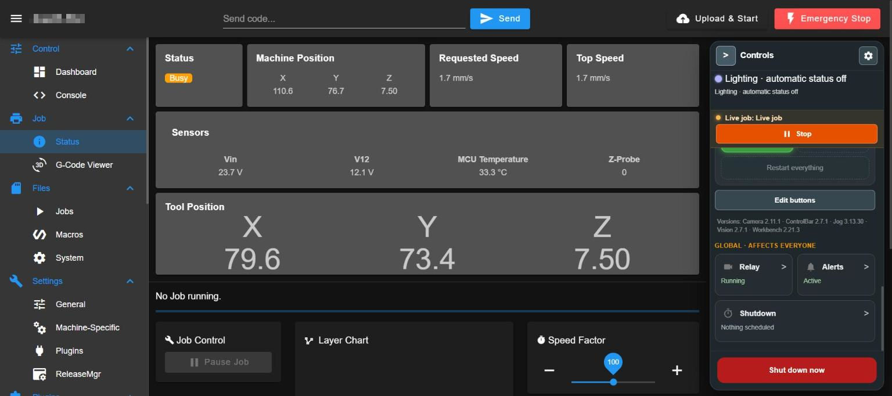
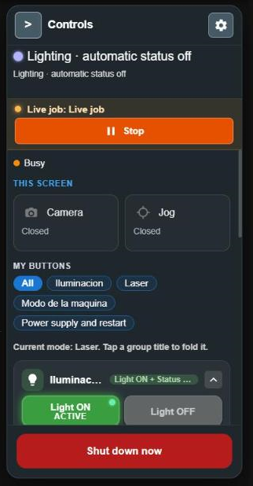
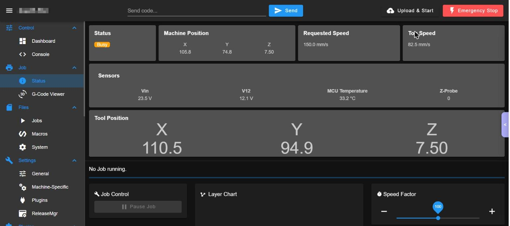
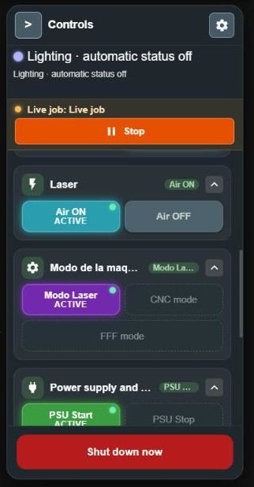
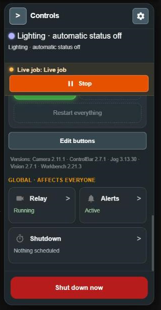
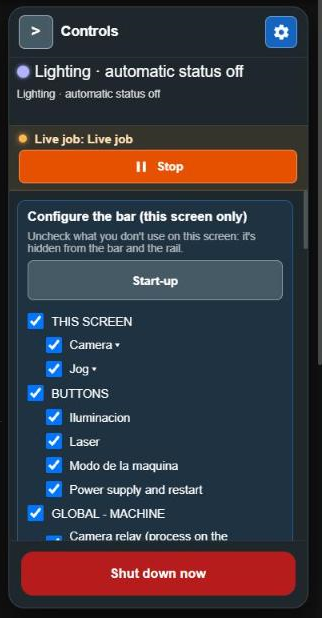
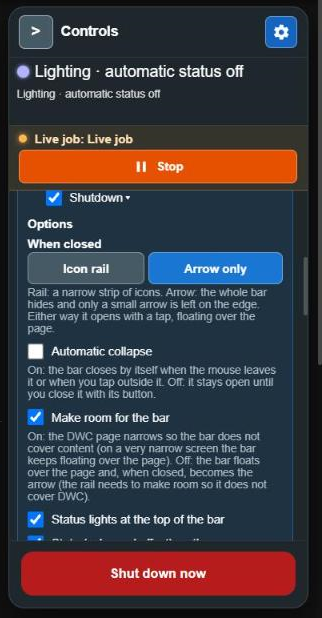
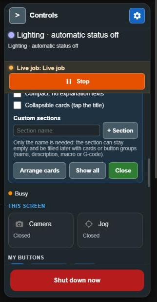
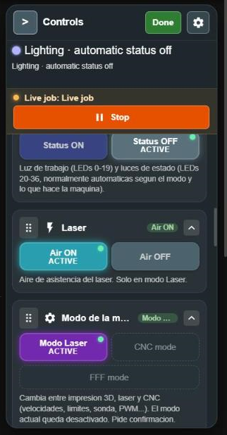

# WorkshopControlBar (Control bar)

A side bar ("Controls") available on every DWC page: machine state with the status light, live-job stop, which floating panels are open on THIS screen (Camera, Jog), your own macro and G-code buttons grouped by function (lighting, laser, machine mode, power supply and restart, CNC zero, power usage), global switches (camera relay, phone notices) and "Shut down now" (safe shutdown of everything). It also schedules the power off at the end of a job.

Version documented: 2.7.x on DWC 3.6.3.

## 1. Requirements

1. WorkshopService running. 2. For "Shut down now" and the end-of-job power off: a shutdown method in the machine profile (`meter` Tuya or `relay` on a Duet output, or software) and the sudoers rule `dsf ALL=(ALL) NOPASSWD: /usr/sbin/poweroff, /usr/sbin/shutdown, /usr/sbin/reboot` in `/etc/sudoers.d/dsf-power`. 3. For the power supply buttons: macros in `macros/psu`; lights: `macros/light`; air: `macros/laser` (the start-up card tells which exist).

## 2. Install

1. Install WorkshopService. 2. DWC > Settings > Plugins > Install `WorkshopControlBar-<ver>.zip`; Start. Reload DWC. 3. The bar appears at the right edge (panel "Controls"; a rail of icons or an arrow when hidden). 4. Verify: it shows the machine state line and "THIS SCREEN" buttons; the start-up chip lists which macros are missing.

## 3. Functions

 The bar is on every DWC page, at the right edge.

Picture 1: the bar open at the right of a DWC page ("Controls"), scrolled to its bottom.

### Status and header

#### Status header (state and status light)
- What: shows the machine state in words (for example "Lighting - automatic status off", then "Busy") and a colored dot that mirrors the status light. Use it to see what the machine is doing from any page.
- Where: top of the bar, under the "Controls" title (picture 2).
- How: nothing to press; it updates by itself.
- Watch out: it only reads. When the bar is collapsed to the arrow, the arrow takes the state color.

Picture 2: top of the bar: title row with ">" and the gear; state line; live job strip with "Stop"; state "Busy"; "THIS SCREEN" with Camera and Jog; "MY BUTTONS" chips.

#### Collapse and open the bar
- What: hides the bar so the page uses the full width, and shows it again.
- Where: ">" button at the top left of the bar (picture 2). When collapsed, a small arrow tab at the right edge of the page (picture 9, middle right).
- How: 1. Press ">" to collapse. 2. Press the arrow tab to open it again.
- Watch out: it is a preference of this screen only. The style when collapsed (arrow or icon rail) is chosen in the gear options.

Picture 9: the bar collapsed to the arrow tab at the right edge (middle right).

#### Live job: Stop safely
- What: stops a live job (a program that sends lines to the machine through the bridge): no more lines get in and what the machine already accepted finishes moving. On a laser the laser goes off and the position is saved to resume later. It is NOT the emergency stop.
- Where: orange strip under the header, labelled "Live job", with the "Stop" button (picture 2). With no live job it says "No live job" and the button is disabled.
- How: 1. Check the strip says a live job is running. 2. Press "Stop". 3. Read the confirmation text and confirm. 4. Wait for "Job stopped safely: no more lines get in.".
- Watch out: it acts on a running job. Operator role. To remove the strip, use the gear option "Safe stop of the live job on the bar".

### Panels of this screen

#### Open or close the Camera panel
- What: opens or closes the floating camera viewer of WorkshopCamera on THIS screen only. It does not stop any process nor affect other users.
- Where: group "THIS SCREEN", button "Camera" with its state "Open" / "Closed" (picture 2).
- How: 1. Press "Camera" to open the viewer. 2. Press it again to close it.
- Watch out: needs WorkshopCamera installed; the group says "No panels installed." otherwise.

#### Open or close the Jog panel
- What: opens or closes the floating Jog panel of WorkshopJog on this screen only.
- Where: group "THIS SCREEN", button "Jog" (picture 2).
- How: same as the camera button.
- Watch out: opening the panel moves nothing; moving is done inside the Jog panel.

### My buttons (macros and G-code)

Picture 3: button groups: Lighting, Laser, Machine mode, Power supply and restart. A green dot and "ACTIVE" mark the current state.

#### Group filter chips and fold a group
- What: chips filter the list ("All" or one group); tapping a group title folds it.
- Where: below "MY BUTTONS", row of chips (picture 2); the group titles carry a small arrow at the right (picture 3).
- How: 1. Tap a chip to show only that group. 2. Tap a group title to fold or open it.
- Watch out: stored for this screen only. The line "Current mode: Laser" tells which machine mode the buttons are judged against.

#### Work light and status LEDs
- What: "Light ON" / "Light OFF" switch the work light (LEDs 0-19); "Status ON" / "Status OFF" switch the status LEDs (LEDs 20-36, normally automatic from the mode and the machine state).
- Where: first group, "Lighting" (the group name is the owner's own) (picture 2, bottom).
- How: 1. Press the button. 2. Wait for the dot and "ACTIVE" to move to it.
- Watch out: it changes the real lights for everyone. A button with no answer in 15 s says "no response in 15 s. It may have run anyway: check the button state before repeating it.". Operator role.

#### Laser air assist
- What: "Air ON" / "Air OFF" run the air assist macros (pump or valve).
- Where: group "Laser" (picture 3, top).
- How: press Air ON or Air OFF.
- Watch out: Laser mode only (grey with a dashed border otherwise, the reason is shown on the button). Needs the macros of `macros/laser`.

#### Machine mode switch
- What: switches the machine between 3D printing (FFF mode), Laser mode and CNC mode (speeds, limits, probe, PWM). The current mode is disabled.
- Where: group "Machine mode" (picture 3, middle).
- How: 1. Press the mode you want. 2. Confirm (double tap, "Confirm?"). 3. Wait for "ACTIVE" to move.
- Watch out: technician role. Not available while a job is running.

#### Power supply and Restart everything
- What: "PSU Start" / "PSU Stop" switch the motor power supply from the Duet; "Restart everything" resets the Duet (M999) and reboots the system in software without cutting power.
- Where: group "Power supply and restart" (picture 3, bottom; "Restart everything" at the top of picture 4).
- How: 1. Press the button. 2. Confirm. 3. After "Restart everything" wait 1-2 minutes for the screen to come back.
- Watch out: Technician role for the supply; administrator for "Restart everything" (`power.full_reset`).

#### CNC zero and Power usage groups
- What: "Capture Zero" saves the current position as a fixed reference and "Set Zero" uses it as the work zero (CNC mode only). The Power usage group reads the energy meter and offers the report buttons (Report, Monthly report, Yearly report).
- Where: groups "CNC zero" and "Power usage" in "MY BUTTONS"; they appear only when the group exists. They are not in the pictures (the machine is in Laser mode).
- How: press the button; the reports open the Power page.

Picture 4: bottom of the bar: "Restart everything", the "Edit buttons" button, the versions line, the group "GLOBAL - AFFECTS EVERYONE" (Relay, Alerts, Shutdown) and the red "Shut down now" button.

#### Edit buttons (add, edit, delete, reorder)
- What: edit mode to change the groups and buttons of "MY BUTTONS". A button is a macro or G-code lines.
- Where: "Edit buttons" button below the groups (picture 4, middle). In edit mode each group shows grip dots to drag (picture 8 shows the same grip dots).
- How: 1. Press "Edit buttons". 2. Drag by the grip dots to reorder, also between groups. 3. In a group press "+ Button" to add, press a button to edit it; delete needs a double tap. 4. Press Done.
- Watch out: It saves to the system and applies to all screens. Technician role.

#### New group
- What: creates a group of buttons with a title, an icon and a description shown under the buttons.
- Where: in edit mode, "New group".
- How: 1. Edit buttons > New group. 2. Fill Title (required: "Title is missing" otherwise), Icon (Light, Air, Crosshair / zero, Gear, Plug, Chart, Star, Grid, Power, Clock) and Description. 3. Save or Cancel.
- Watch out: "Delete the group WITH its buttons (double tap)" removes every button of the group.

#### New button and modes where it is active
- What: a button runs a macro of the `macros/` folder or one or more G-code lines.
- Where: "+ Button" inside a group, in edit mode.
- How: 1. Write the button text. 2. Choose "Run a macro" (pick from the list) or "Send G-code". 3. Choose a color. 4. Tick the modes where the button is enabled (at least one; outside them it is disabled). 5. Optional: "Shows as ON (ACTIVE) when" an object model path equals a value (for example `state.atxPower`), "Ask for confirmation (double tap)", "Can be used while a job is running". 6. Save.
- Watch out: a button runs the macro exactly as written. Buttons that cannot be used now are grey with a dashed border and the reason below.

### Global (affects everyone)

#### Camera relay
- What: card "Relay" shows whether the camera relay process on the system runs; opening it offers "Stop relay" / "Start relay".
- Where: group "GLOBAL - AFFECTS EVERYONE", card "Relay" (picture 4).
- How: 1. Open the card (">"). 2. Press "Stop relay", then press again to confirm ("Tap again: cut it for EVERYONE").
- Watch out: stopping it cuts the camera for EVERYONE watching. To stop watching on your screen only, close the camera panel.

#### Phone alerts mute
- What: card "Alerts" shows whether phone notifications are Enabled, Muted until a time, or disabled; opening it offers "Mute 1 h" / "Unmute now".
- Where: card "Alerts" (picture 4).
- How: 1. Open the card. 2. Press "Mute 1 h" or "Unmute now".
- Watch out: mute is for ALL who receive; events keep being logged in Activity; it turns on again by itself after 1 hour. The destination is set on the Activity page.

#### Shut down when done and timer
- What: card "Shutdown" schedules the power off for when the current job ends (or the next one that starts and ends), or after a timer of 1 to 720 minutes.
- Where: card "Shutdown", state "Nothing scheduled" (picture 4).
- How: 1. Open the card. 2. Choose "Arm shutdown when done", or enter the minutes and press "Schedule". 3. To cancel press "Cancel shutdown when done" or "Cancel scheduled shutdown".
- Watch out: It works with no screen open, warns 1 minute before and never cuts a running job. The method ("How it powers off": Meter, Relay, PS_ON or only the system) is set in the same card. Administrator role. If you leave it armed, the machine powers off.

#### Shut down now
- What: shuts the system down and cuts the power of everything (GLOBAL).
- Where: red button at the bottom of the bar, always visible (pictures 1 and 4).
- How: 1. Press "Shut down now". 2. The button asks for a second press within a few seconds ("Tap again to shut everything down in ..."). 3. Confirm only if you mean it.
- Watch out: NOT pressed. Administrator role (`power.off`). It runs sync, cuts the meter and then shutdown. It cannot be turned on again remotely.

### Gear options (configure the bar)

Picture 5: gear open: "Configure the bar (this screen only)", the "Start-up" button and the list of sections to show.

#### What shows and the start-up card
- What: tick or untick each section (THIS SCREEN, BUTTONS and each group, GLOBAL - MACHINE with Camera relay, Alerts, Shutdown) to show it in the bar and the rail on this screen. "Start-up" opens the card that lists which macro files the buttons need (light, air, power supply).
- Where: gear at the top right of the bar > top of the options (picture 5).
- How: 1. Press the gear. 2. Untick what you do not use. 3. Press "Close" at the bottom.
- Watch out: hidden buttons are not deleted. Per screen.

Picture 6: gear options: "When closed" (Icon rail / Arrow only), "Automatic collapse", "Make room for the bar" and the status lights option.

#### Style when closed (Icon rail or Arrow only)
- What: "Icon rail" leaves a narrow strip of icons; "Arrow only" hides the bar and leaves a small arrow on the edge.
- Where: gear > "Options" > "When closed" (picture 6, top).
- How: choose one of the two buttons.
- Watch out: either way it opens with a tap, floating over the page.

#### Automatic collapse (close on mouse out)
- What: when on, the bar closes by itself when the mouse leaves it or you tap outside it.
- Where: gear > Options > "Automatic collapse" (picture 6).
- How: tick or untick.

#### Make room for the bar
- What: on, the DWC page narrows so the bar does not cover content (on a very narrow screen the bar floats). Off, the bar floats over the page.
- Where: gear > Options > "Make room for the bar" (picture 6).
- How: tick or untick.

#### Status lights, arrow state, compact and collapsible cards
- What: "Status lights at the top of the bar" (the header status), "State (color and effect) on the arrow", "Safe stop of the live job on the bar", "Compact: no explanation texts", "Collapsible cards (tap the title)".
- Where: gear > Options (pictures 6 and 7).
- How: tick or untick each; it applies at once on this screen.

Picture 7: bottom of the gear options: custom sections, "Arrange cards", "Show all" and "Close".

#### Custom sections, Arrange cards and Show all
- What: "+ Section" creates an empty named section to fill with cards or button groups; "Arrange cards" lets you drag sections and cards; "Show all" shows again everything hidden.
- Where: bottom of the gear options (picture 7).
- How: 1. Type a section name and press "+ Section". 2. Press "Arrange cards", drag by the grip dots and press "Done" (picture 8).
- Watch out: layout only, per screen.

Picture 8: arrange mode: grip dots at the left of each group title and the "Done" button next to the gear (top right).

## 4. Settings

| Setting | Meaning | Default | If wrong |
|---|---|---|---|
| Visible sections / order | What the bar shows on this screen | all | Hidden buttons are not lost |
| Closes by itself | Bar hides on mouse out | per screen | n/a |
| Page pushes | DWC content narrows | on | Bar covers content if off |
| Rail or Arrow | Collapsed style | Rail | n/a |
| Button groups | Macros / G-code per mode | factory groups | A button runs the macro as written |
| Power off after job method | Meter / Relay / timer | profile | Wrong method: nothing happens |

Button groups and global options are saved in the system and apply to all screens; layout options are per screen.

## 5. Roles

Looking: any role. Buttons act with the role of the macro/operation: lights and mute: operator; machine mode and power supply: technician; "Shut down now", "Restart everything" and power off scheduling: administrator (`power.off`, `power.full_reset`, `power.after_job`, `power.timer`). Without users: admin, so anyone with DWC access can press "Shut down now".

## 6. API operations used

`power.off`, `power.full_reset`, `power.after_job`, `power.method`, `power.timer`, `power.timer_cancel`, `camera.start`, `camera.stop`, `camera.url`, `light.set`, `lights.save`, `notifications.get`, `notifications.mute`, plus macro / G-code execution through the allowed channel.

## 7. Troubleshooting

1. Lighting buttons missing: the macro file `macros/light/...` has no active line; edit it or tap "Do not use" in the start-up card.
2. "Shut down now" does nothing: missing sudoers rule or Tuya key rotated; see Power and the service notes.
3. "Restart everything" and the screen does not return: wait 1-2 minutes; the kiosk reloads by itself.
4. Button said "no response in 15 s": check its state before pressing again.
5. After a click in this panel a stray press once powered the machine off: always keep the panel closed or locked when you are not using it.

<!-- permissions:start -->

## Permissions and what it changes

Risk: **Medium (buttons that shut the machine down or run your macros)**. Read this before installing; the full document is `security.md` of the Workshop plugins.

**DSF permissions:** none. It is a page of DWC (it runs in your browser) and everything it does goes through the API of `WorkshopService`, which applies the roles (viewer, operator, technician, administrator) in the server.

**Depends on:** `WorkshopService` (install it first, uninstall it last).

**Files it writes:**
- its buttons and groups in `0:/sys/workshop/config/`

**What it needs outside the zip** (each one is a separate step you do on purpose and can undo):
- the shutdown and restart buttons need the optional sudo rule of the service (`/etc/sudoers.d/dsf-power`)

**Safety notes:**
- "Shut down now" cuts the power of EVERYTHING through the Tuya breaker if you configured one; it asks for confirmation.

Uninstalling removes the plugin folder; your data in `0:/sys/workshop/` and `/opt/dsf/conf/workshop-*.json` stays.

<!-- permissions:end -->

## 8. Limits

Power off through meter needs the Tuya meter reachable; "Restart everything" does not cut power; the shutdown is final: the Tuya meter cannot turn the machine on again remotely.

